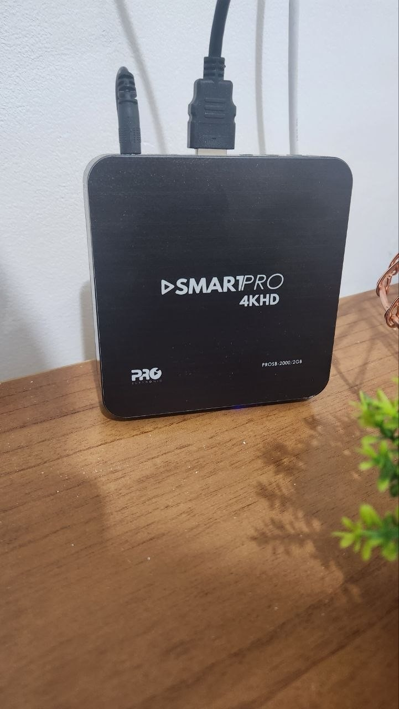
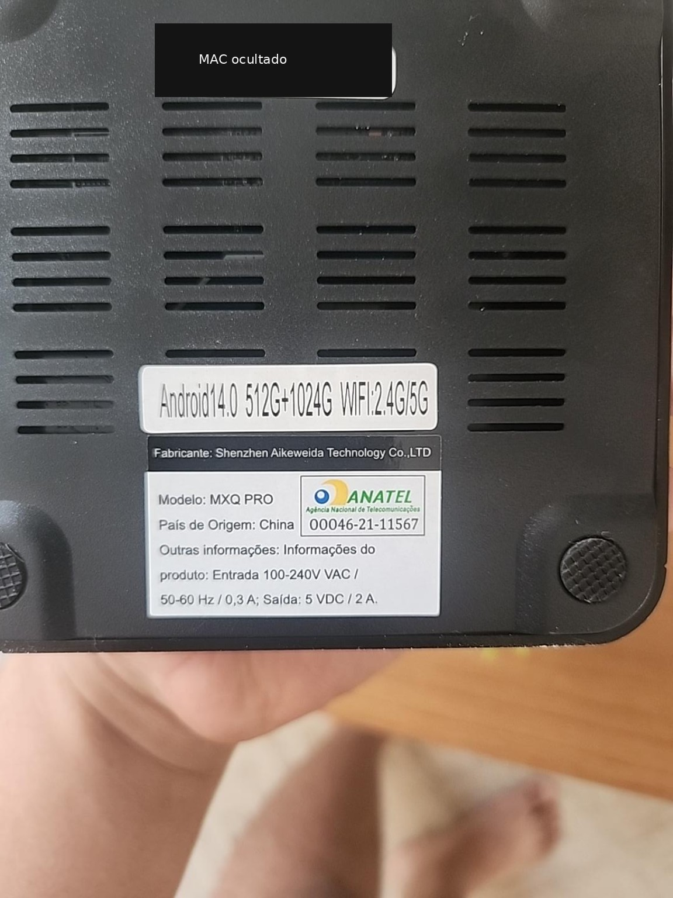
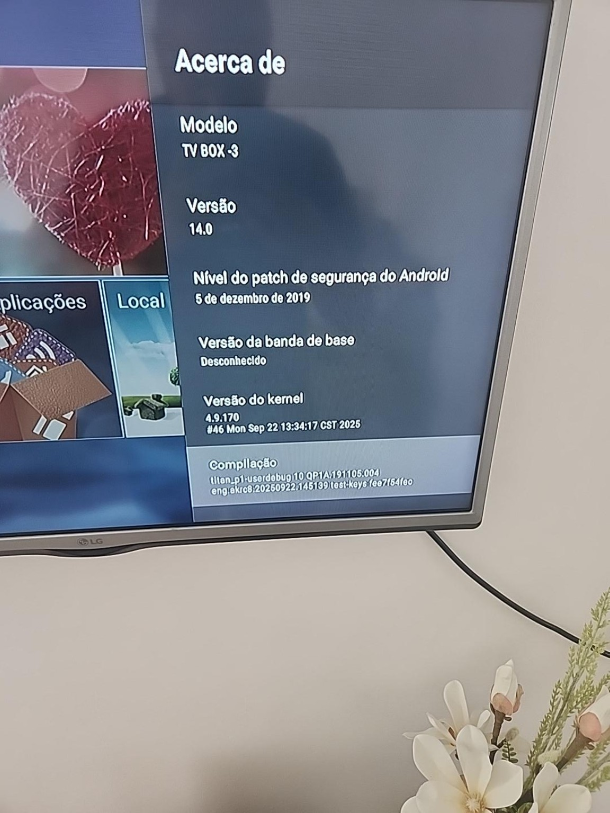
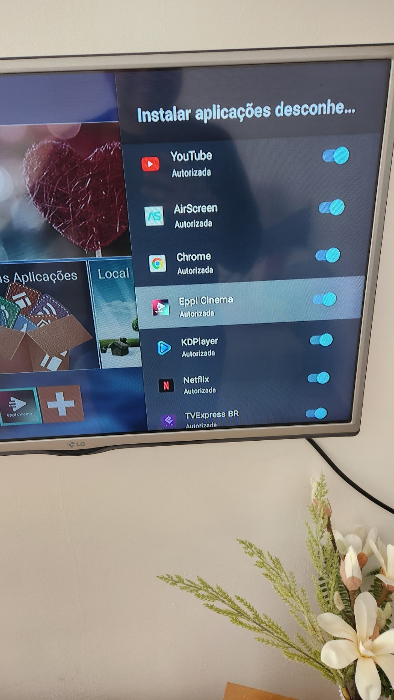
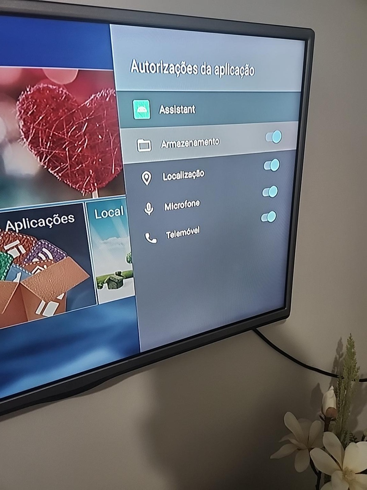
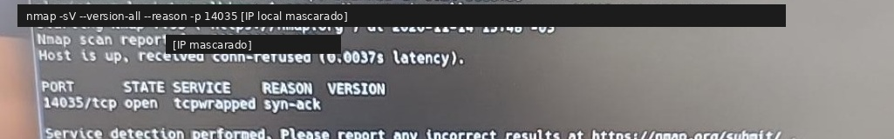

# Evidências da investigação

Esta pasta reúne registros visuais selecionados durante a investigação independente de segurança da TV Box comercializada como SMAR1 PRO e identificada na etiqueta como MXQ PRO.

As imagens estão organizadas para documentar características físicas do equipamento, informações do sistema, permissões Android e resultados de reconhecimento de rede.

## 1. Identificação do equipamento

### 01. Frente do equipamento

Registro visual da identificação comercial apresentada na parte frontal do dispositivo.

### 02. Etiqueta e identificação regulatória

Registro da etiqueta física, incluindo modelo declarado e identificação de homologação Anatel.

## 2. Informações do sistema

### 03. Versão do Android e informações de compilação

Captura das informações exibidas pelo sistema, incluindo versão declarada do Android, kernel, nível do patch de segurança e identificação da compilação.

Os identificadores apresentados devem ser analisados em conjunto. Isoladamente, não comprovam adulteração ou comprometimento.

## 3. Permissões e aplicativos

### 04. Autorização para instalar aplicativos desconhecidos

Registro dos aplicativos que possuíam autorização para solicitar ou realizar instalações de fontes externas no momento da captura.

A presença da autorização representa uma possibilidade de instalação, não comprova que ela foi utilizada.

### 05. Permissões do aplicativo Assistant

Registro das permissões concedidas ao aplicativo identificado como Assistant durante a inspeção.

As permissões documentam a capacidade potencial disponibilizada ao aplicativo, não comprovam, por si só, o uso dessas capacidades.

## 4. Reconhecimento de rede

### 06. Resultado da varredura Nmap

Registro do resultado da varredura de rede que identificou a porta TCP 14035 como aberta, com identificação `tcpwrapped`.

O resultado não permitiu identificar o serviço ou processo associado à porta.

## Critérios e limitações

As imagens foram selecionadas por sua relevância para documentar os procedimentos e resultados observados.

Os registros representam estados específicos do equipamento durante a investigação. Não devem ser interpretados isoladamente como comprovação de malware, adulteração ou atividade maliciosa.

Os procedimentos, resultados complementares e limitações técnicas estão descritos no relatório e na documentação metodológica do projeto.
